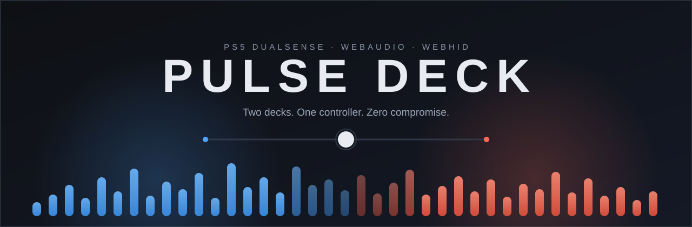

<p align="center">
  
</p>

<h1 align="center">Pulse Deck</h1>

<p align="center">
  <b>Turn a PS5 DualSense into a full two-deck DJ console — right in your browser.</b><br/>
  Touchpad jog wheels. Gyro FX. Adaptive triggers. Beat-synced lightbar.<br/>
  No drivers. No hardware mods. Just the controller already on your desk.
</p>

<p align="center">
  <b>▶ <a href="https://ezzy1231.github.io/pulse-deck/">Try the live demo in your browser</a></b> — no install, just click START<br/><br/>
</p>

<p align="center">
  <a href="https://ezzy1231.github.io/pulse-deck/"></a>
  <a href="https://github.com/ezzy1231/pulse-deck/releases/latest"></a>
  <a href="#quick-start"></a>
  <a href="#quick-start"></a>
  <a href="#quick-start"></a>
  <a href="#desktop-app"></a>
  <a href="#dualsense-superpowers"></a>
  
  
  
</p>

<!-- Drop a screen recording here to boost this README: <p align="center"></p> -->

---

## Why

DJ software is expensive, and mixing with a keyboard feels like filling out a spreadsheet. Meanwhile there's a haptically brilliant, gyro-equipped, touchpad-bearing controller sitting on your desk doing nothing.

Pulse Deck maps **the entire DualSense** onto a real DJ workflow over **WebHID** — not the watered-down Gamepad API. The touchpad becomes a jog wheel. The gyro becomes an FX unit. The triggers push back on your fingers while the track plays. The lightbar is your VU meter.

Open a browser tab. Press START. Drop in some tracks. Start mixing.

## Features

### 🎛 The DJ engine
- **Two full decks** — play/cue state machine, hot cues, 4-beat loops, pitch faders, and PLL-based SYNC that actively corrects drift (±12% bend)
- **Mixer** — equal-power crossfader, 3-band EQ, morphing low/high-pass filter, echo & reverb send FX
- **Key lock** — tempo changes without the chipmunk effect, powered by SoundTouchJS
- **Library** — searchable session library, browse and load entirely from the controller
- **Waveforms & BPM detection** — click-scrub on the waveform, auto BPM analysis on load

### 🎮 DualSense superpowers
- **Touchpad jog wheels** — left half scrubs Deck A, right half Deck B. Scratch or nudge mode; click the touchpad to toggle
- **Gyro FX** — tilt the controller to open echo/reverb. Hold L3 to arm Deck A, R3 for Deck B
- **Adaptive triggers** — L2/R2 are your channel faders, and they fight back: stiffness while playing, a buzz when the track is about to end
- **Haptics** — downbeat pulses in your hands, cue thumps, clipping warnings
- **Lightbar** — deck colors blended live by the crossfader, beat-synced pulse, red flash on clipping
- **Player LEDs** — five dots as a master VU meter
- **PS button = PANIC** — one press fades the master out. Every DJ's best friend
- **Live remapping** — rebind any action from the in-app profile editor; it persists and follows you

### 🖥 Desktop app
- Runs as a native Windows app via Electron, with an installer and a portable `.exe`
- Full WebHID support wired up — no browser permission dance

## Quick start

```bash
npm install
npm run dev
```

1. Open `http://localhost:5173`
2. Hit **START** (browsers require a click before audio can play)
3. Load a couple of tracks with the **LOAD** button on each deck
4. Plug in your DualSense over **USB** and it just works

> Bluetooth exposes standard gamepad inputs only. Touchpad, gyro, haptics, and lightbar need USB — raw HID reports aren't available over BT in the browser.

## Controller map (defaults)

| Input | Action |
| --- | --- |
| D-pad ↓ / ← / → / ↑ | Deck A: play · cue · sync · loop |
| ✕ / ○ / □ / △ | Deck B: play · cue · sync · loop |
| L1 / R1 + deck buttons | Hot cues 1–4 |
| L2 / R2 | Channel faders A / B (with adaptive trigger feedback) |
| Left / right stick X | Filter A / B |
| Left / right stick Y | Pitch bend A / B (hold L1/R1 for tempo) |
| Create + left stick | Crossfader |
| Create + right stick Y | Master volume |
| Options | Toggle library browse |
| Touchpad | Jog wheels (click to toggle scratch/nudge) |
| L3 / R3 (hold) | Arm gyro FX for A / B |
| PS | Panic — fade out master |

Browse mode: D-pad or left stick to scroll · L1/R1 or ←/→ to pick target deck · ✕ or L2/R2 to load · ○ to close.

Everything above is rebindable — open **Settings** from the header pill, hit REBIND, press a button.

## Keyboard

| Key | Action |
| --- | --- |
| `Q` / `W` | Cue / play Deck A |
| `O` / `P` | Cue / play Deck B |
| `B` | Toggle library browse (arrows to move, Enter to load) |
| `S` | Settings & mapping editor |

## Desktop app

Grab the latest build from [Releases](https://github.com/ezzy1231/pulse-deck/releases/latest) — installer or portable, no toolchain needed. Or build it yourself:

```bash
npm run electron   # dev run as a desktop window
npm run package    # build the Windows installer + portable exe
```

Artifacts land in `release/`. The builds are unsigned, so SmartScreen will grumble the first time — *More info → Run anyway*.

## Under the hood

- **Raw HID, not the Gamepad API** — the DualSense is parsed at the report level: sticks, buttons, gyro, touch coordinates, and the full output report (rumble motors, adaptive trigger effects, lightbar, player LEDs) at 250 Hz with live latency telemetry
- **One typed event bus** — UI, audio engine, and controller layer never touch each other directly; `wire.ts` is the single wiring point
- **Real DJ math** — equal-power crossfade, exponential pitch-rate integration with glide, PLL sync correction, 30 ms granular scratch
- **Key lock that loops** — SoundTouch WSOLA time-stretching with loop-wrap reseeking, driven from the audio callback
- **Feedback loop** — a 60 fps envelope engine maps beats, cues, clipping, and track endings onto haptics and the lightbar
- **A hex log panel** in the controller card, because HID offsets deserve to be debuggable

| Layer | Choice |
| --- | --- |
| UI | React 19 · Zustand · hand-rolled CSS |
| Build | Vite 7 · TypeScript 5.9 (strict) |
| Audio | Web Audio API — custom deck/engine graph |
| Controller | WebHID (raw reports) + Gamepad API |
| Pitch/time | SoundTouchJS · web-audio-beat-detector |
| Desktop | Electron 44 · electron-builder |

## Project structure

```
src/
  audio/         Web Audio engine + decks (key lock, scratch, sync)
  controllers/   DualSense HID, sensors, feedback, mapping profile, gamepad
  state/         Zustand store
  ui/            Decks, mixer, library, waveform, settings modal
  actions/       Typed event bus
  wire.ts        Wires bus events to the engine
electron/        Desktop shell (WebHID permissions included)
spec/            The original product spec
```

## Honest limitations

- Full DualSense experience needs **USB** (Bluetooth: standard inputs only)
- Key-lock loop wraps re-prime the stretcher — a tiny dip, roughly 50 ms
- HID report offsets are reverse-engineered; if a firmware update shifts them, use the built-in hex log
- Windows builds are unsigned

## Roadmap

- Recording / mix export
- Beatgrid editing with the jog wheels
- MIDI-out for hybrid setups

## Credits

Built on the shoulders of: [SoundTouchJS](https://github.com/cutterbl/SoundTouchJS) · [web-audio-beat-detector](https://github.com/chrisguttandin/web-audio-beat-detector) · [Zustand](https://github.com/pmndrs/zustand) · [Vite](https://github.com/vitejs/vite) · [Electron](https://github.com/electron/electron)

DualSense HID protocol informed by [SDL](https://github.com/libsdl-org/SDL) and the Linux `hid-playstation` kernel driver.

## Contributing

PRs are welcome — controllers, effects, and UI polish especially. Fork it, break it, fix it, send it back.

## License

MIT — use it, remix it, ship it. Just keep the copyright notice. See [LICENSE](LICENSE) for details. Bundled dependencies keep their own licenses (see Credits).

---

<p align="center">
  <b>If this made you want to DJ, drop a ⭐ — it helps other people find it.</b><br/>
  <sub>Now go make something loud.</sub>
</p>
